# Pet Care

Evcil hayvanlar için sağlık takibi ve sosyal ağ uygulaması. Flutter ile geliştirildi.

Veteriner geçmişini ve yaklaşan randevuları takip edin, diğer evcil hayvan sahipleriyle tanışın, yakındaki veteriner kliniklerini haritada görün.

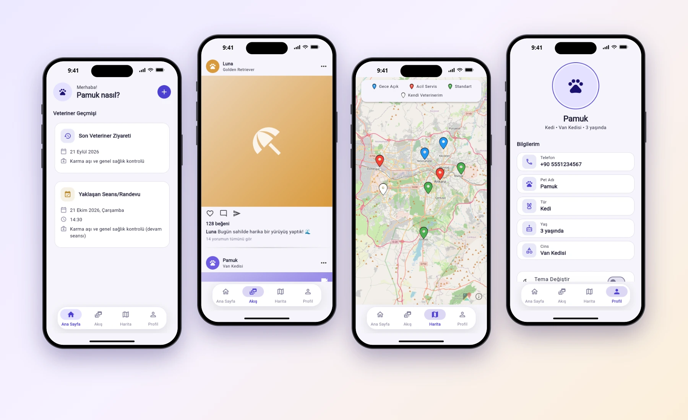

## Özellikler

- **Telefon ile giriş:** Yalnızca telefon numarası ve SMS doğrulama kodu ile giriş. Giriş bilgisi cihazda saklanır, uygulama her açıldığında yeniden istenmez.
- **Evcil hayvan profili:** Ad, yaş, tür (kedi, köpek, kuş vb.), cins ve galeriden seçilen yuvarlak profil fotoğrafı. Fotoğraf profil ekranından istenildiğinde değiştirilebilir.
- **Veteriner geçmişi:** Son ziyaret ve yaklaşan randevu kartları. Yeni kayıt eklerken yapılan işlem ve sonraki seans tarihi girilir; sonraki seans yoksa "Son seans" seçilir. Randevu yoksa şık bir boş durum gösterilir.
- **Akış:** Gönderi akışı, beğeni, yorum ve paylaşım ikonları. Avatara dokununca ön gösterim profili açılır, buradan sohbete geçilir.
- **Sohbet:** Giden mesajlar sağda, gelenler solda olan mesajlaşma ekranı.
- **Harita:** Ankara'daki veteriner klinikleri, kategoriye göre renkli işaretçilerle gösterilir: gece açık (mavi), acil servis (kırmızı), standart (yeşil). Kullanıcı bir kliniği "kendi veterineri" olarak seçebilir (beyaz işaretçi). Üstte renkleri açıklayan bir gösterge çubuğu bulunur.
- **Profil:** Kayıt bilgileri, açık/koyu tema anahtarı ve onay isteyen "Tüm Verilerimi Sil" işlemi.
- **Tema:** Merkezi bir tema dosyasından yönetilen açık ve koyu renk paleti.

## Ekran Görüntüleri

Ekran görüntüleri uygulamanın web derlemesinden alınmış ve cihaz çerçevesi içinde sunulmuştur.

| Giriş | Ana Sayfa | Veteriner Kaydı | Akış |
| :---: | :---: | :---: | :---: |
| 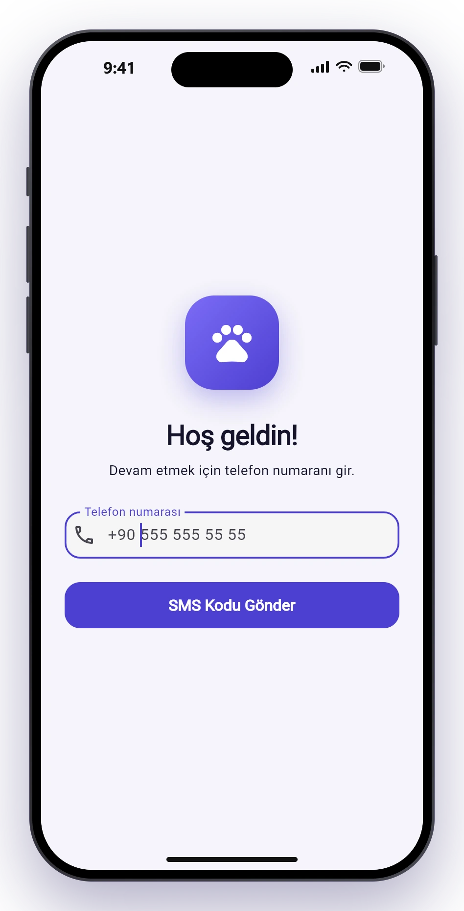 | 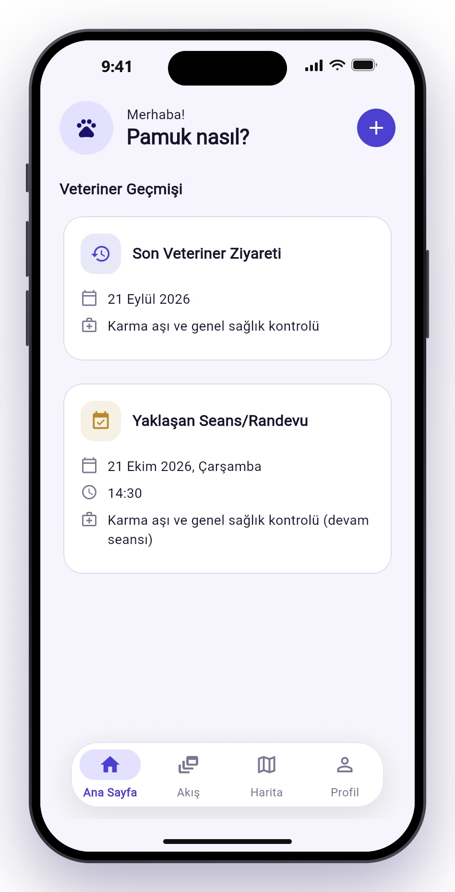 | 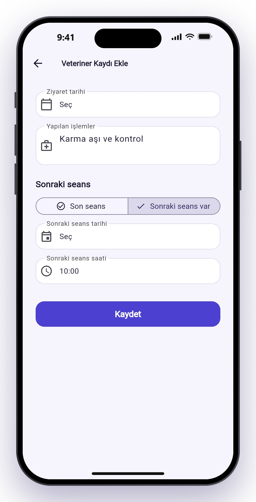 | 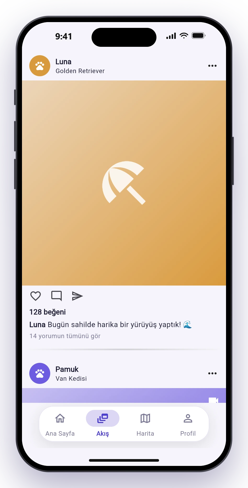 |

| Ön Gösterim | Sohbet | Harita | Klinik Kartı |
| :---: | :---: | :---: | :---: |
| 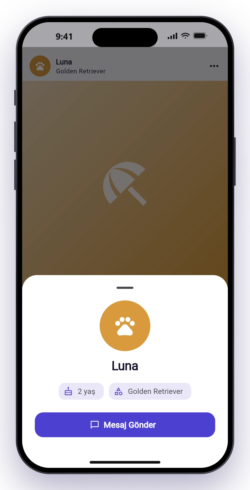 | 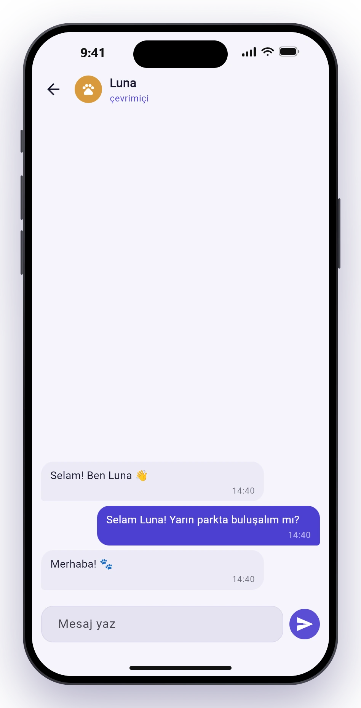 | 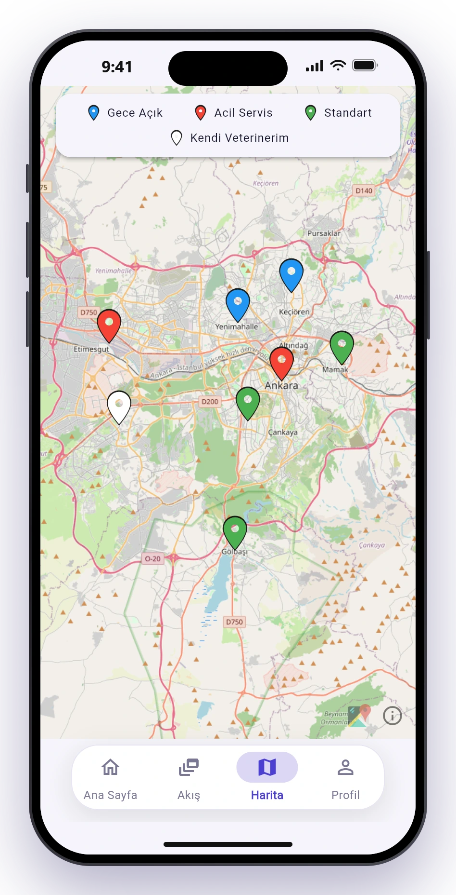 | 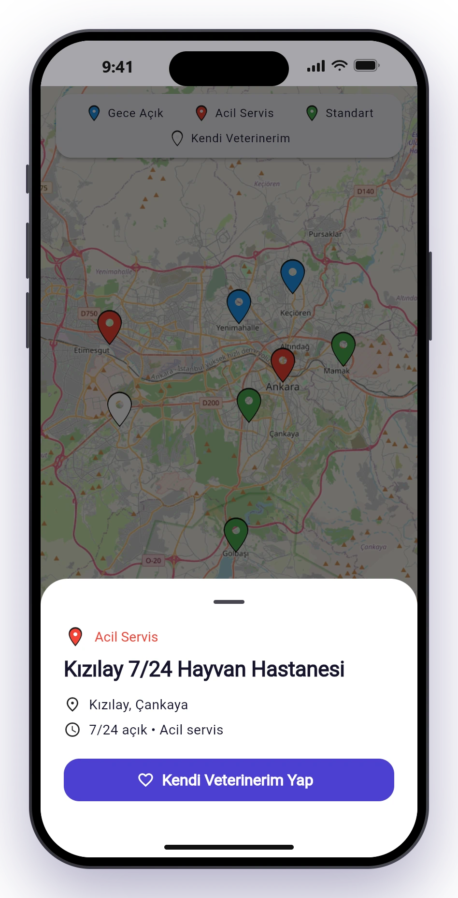 |

| Profil | Koyu Tema: Ana Sayfa | Koyu Tema: Profil |
| :---: | :---: | :---: |
| 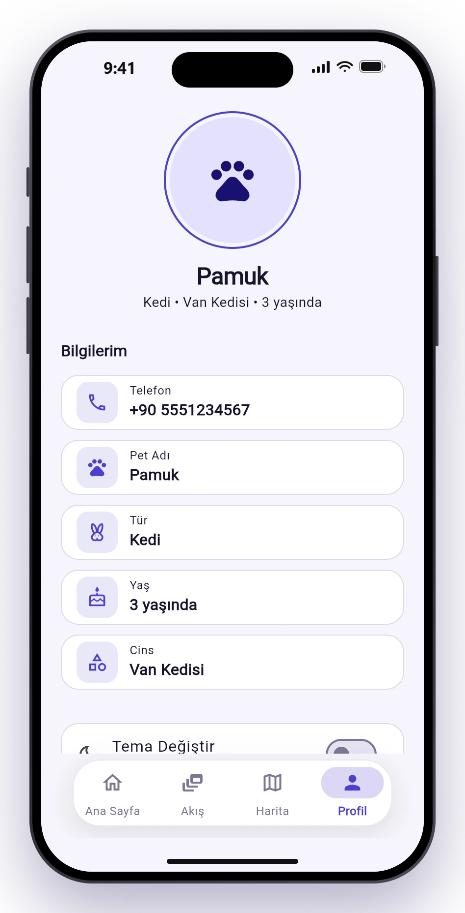 | 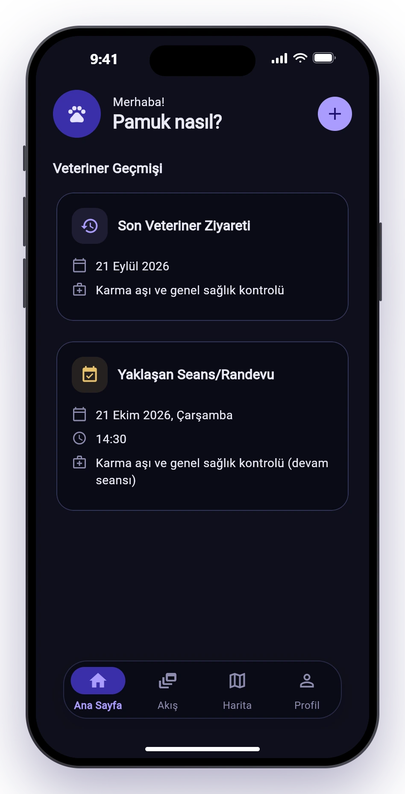 | 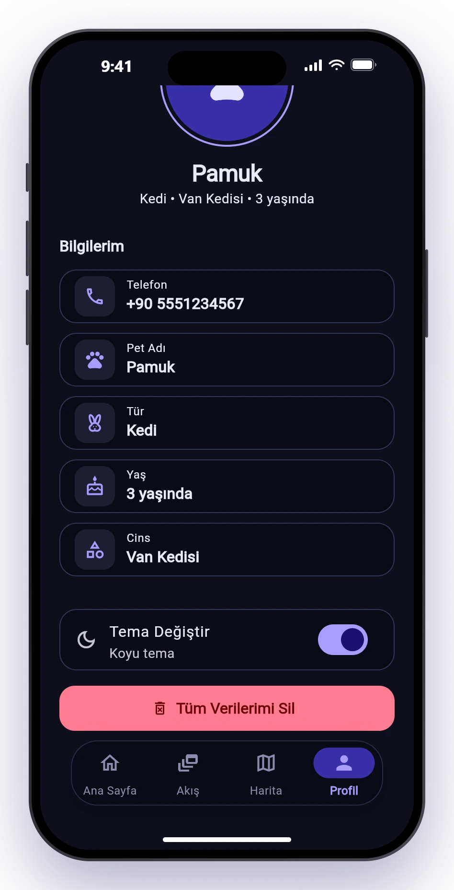 |

## Kullanılan Teknolojiler

- [Flutter](https://flutter.dev) ve Material 3
- [`shared_preferences`](https://pub.dev/packages/shared_preferences): cihaz hafızasında kalıcı veri
- [`image_picker`](https://pub.dev/packages/image_picker): galeriden fotoğraf seçimi
- [`flutter_map`](https://pub.dev/packages/flutter_map) ve [`latlong2`](https://pub.dev/packages/latlong2): OpenStreetMap tabanlı harita

## Çalıştırma

```bash
flutter pub get
flutter run -d chrome
```

Demo aşamasında telefon alanında `555 555 55 55`, doğrulama ekranında `123456` silik ipucu olarak gösterilir. Doğrulama için geçerli kod `123456`'dır.

## Proje Yapısı

```text
lib/
├── main.dart              # Giriş noktası ve açılış yönlendirmesi
├── app_state.dart         # Uygulama genelindeki tema ve yenileme durumu
├── theme/                 # Renk paleti ve bileşen stilleri
├── models/                # Veri modelleri
├── services/              # Depolama ve (demo) veri kaynakları
├── screens/               # Giriş, doğrulama, kayıt, sohbet ve ana iskelet
│   └── tabs/              # Ana Sayfa, Akış, Harita, Profil sekmeleri
└── utils/                 # Yardımcı fonksiyonlar
```

## Notlar

- Akış, klinik ve veteriner kayıtları şimdilik demo verilerle çalışır; veri kaynakları `services/` altında arayüzden ayrılmıştır, bir sunucuya bağlanırken yalnızca bu katman değişir.
- Harita karoları OpenStreetMap'in herkese açık sunucusundan gelir. Yayına almadan önce kendi karo sağlayıcınıza geçmeniz önerilir.
